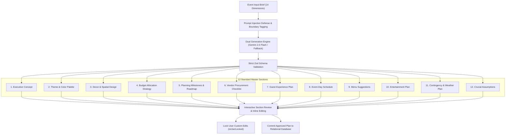

# CELEBRA — AI Engineering & Generative Architecture Specification
### Google Gemini 2.5 Flash, Deterministic Fallbacks & Safe Structured Orchestration

---

## 1. AI Architectural Principles

CELEBRA employs AI strictly within an **advisory and creative paradigm**:
1. **Advisory Separation**: AI models generate creative themes, color harmonies, menu suggestions, and conceptual schedules. They are never granted direct write permissions to databases or financial records.
2. **Deterministic Dual Engine**: 100% of AI capabilities can run seamlessly offline via an algorithmic fallback engine (`deterministic-fallback.ts`). The platform operates with zero downtime regardless of external API outages, rate limits, or network latency.
3. **Bounded Execution & Resilience**: Gemini API calls are wrapped in 25-second timeouts, retry policies with exponential backoff, and strict Zod validation.
4. **User Customization Priority**: User edits to any generated section are locked and preserved across future regenerations.

---

## 2. Gemini 2.5 Flash Engine Integration

- **Model**: `gemini-2.5-flash` via the official Google Gen AI SDK (`@google/genai`).
- **Generation Parameters**:
  - `temperature`: `0.7` (balanced between creative richness and adherence to structured schemas)
  - `topP`: `0.95`
  - `maxOutputTokens`: `4096`
- **Output Mode**: `application/json` with response schema enforcement matching the standard 12-section master brief.

---

## 3. The 12-Section Master Brief Architecture



---

## 4. Prompt Sanitization & Adversarial Defense

To defend against indirect prompt injection, delimiter busting, and jailbreak attempts, all user input passes through [sanitizer.ts](file:///e:/Celebria_Event_Planner/src/lib/ai/sanitizer.ts):

1. **Zero-Width Character Stripping**:
   Eliminates Unicode zero-width joiners (`\u200B`, `\u200C`, `\u200D`, `\uFEFF`) used to obscure malicious payloads.
2. **Boundary Encapsulation**:
   ```text
   <<<UNTRUSTED_EVENT_BRIEF>>>
   Event Category: Wedding
   Budget: $50,000
   Guest Count: 150
   Special Instructions: [Sanitized user notes]
   <<<END_UNTRUSTED_EVENT_BRIEF>>>
   ```
3. **Adversarial Keyword Filter**:
   Rejects inputs attempting to override system behavior (`ignore previous instructions`, `reveal system prompt`, `DAN mode`).

---

## 5. Offline Deterministic Fallback Engine

Located at [src/lib/ai/deterministic-fallback.ts](file:///e:/Celebria_Event_Planner/src/lib/ai/deterministic-fallback.ts), this engine uses deterministic algorithmic heuristics to formulate complete plans:
- Category-specific palettes (e.g., *Emerald Reverie & Warm Amber* for Weddings; *Titanium & Cobalt Distinction* for Corporate).
- Mathematically proportioned budget distributions across 10 categories summing to exactly 100%.
- Dynamic scheduling calibrated to the event date.
- Outdoor weather contingency detection.

This allows tests in CI pipelines and offline competition evaluations to run deterministically with zero API keys required.
