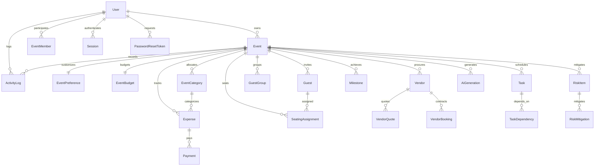

# CELEBRA — Database Architecture & Schema Specification
### II2S Challenge 5: Celebration & Event Planner

---

## 1. Overview & Dual Persistence Architecture

CELEBRA employs a **dual persistence architecture** that combines immediate, zero-configuration local development capability with production-grade PostgreSQL scalability:

1. **Development & CI Database**:
   - Engine: **SQLite** via [prisma/schema.prisma](file:///e:/Celebria_Event_Planner/prisma/schema.prisma) (`file:./dev.db`).
   - Enables immediate execution, reproducible testing, and zero external dependency friction in competition evaluation sandboxes.
2. **Production Database**:
   - Engine: **PostgreSQL 15+** via [prisma/postgresql.schema.prisma](file:///e:/Celebria_Event_Planner/prisma/postgresql.schema.prisma) and migration script [prisma/migrations/0_init_postgresql.sql](file:///e:/Celebria_Event_Planner/prisma/migrations/0_init_postgresql.sql).
   - Full PostgreSQL DDL featuring native UUIDs, BigInt minor currency units, foreign key cascades, and high-performance B-tree indexes.

---

## 2. Entity Relationship Overview

---

## 3. Core Relational Entities Specification

### User & Authentication
- **User**:
  - `id`: UUID Primary Key
  - `email`: Case-insensitive unique string
  - `passwordHash`: Salted Scrypt hash string (format: `salt:derivedKey`)
  - `name`: Full display name
  - `role`: System role (`HOST`, `PLANNER`, `COLLABORATOR`, `ADMIN`)
  - `createdAt`, `updatedAt`: Timestamps
- **Session**:
  - `id`: UUID Primary Key
  - `userId`: Foreign key to `User(id)` with `CASCADE` delete
  - `token`: Unique HMAC-SHA256 signature
  - `expiresAt`: Absolute expiration timestamp
- **PasswordResetToken**:
  - `token`: Cryptographic reset token with 1-hour expiration

### Event & Workspace Governance
- **Event**:
  - `id`: UUID Primary Key
  - `ownerId`: Foreign key to `User(id)`
  - `title`: Celebration title
  - `slug`: Human-readable unique identifier
  - `eventType`: Celebration category (`WEDDING`, `BIRTHDAY`, `ANNIVERSARY`, `ENGAGEMENT`, `BABY_SHOWER`, `CORPORATE`, `COMMUNITY`, `CULTURAL`, `CUSTOM`)
  - `startDate`, `endDate`: ISO 8601 timestamps
  - `venue`, `city`, `country`: Location details
  - `guestTarget`: Target headcount
  - `budgetMinor`: Total budget in 64-bit integer minor currency units (`BigInt`)
  - `currency`: 3-letter ISO code (`USD`, `EUR`, `GBP`, etc.)
  - `status`: Lifecycle status (`PLANNING`, `CONFIRMED`, `IN_PROGRESS`, `COMPLETED`, `CANCELLED`)
- **EventMember**:
  - `[eventId, userId]`: Unique composite constraint
  - `role`: Role-based access control tier (`OWNER`, `PLANNER`, `COLLABORATOR`, `VIEWER`)

### Financial Ledger
- **EventBudget**:
  - `totalBudgetMinor`: BigInt minor units
  - `contingencyPercent`: Reserve percentage (default: 10%)
- **EventCategory**:
  - `name`: Category name (`Venues`, `Catering`, `Photography`, etc.)
  - `allocatedMinor`: Allocated minor units
  - `actualSpentMinor`: Reconciled spent minor units
- **Expense**:
  - `baseAmountMinor`: Integer base cost
  - `taxBasisPoints`: Tax percentage in basis points ($1 \text{ bp} = 0.01\%$)
  - `taxAmountMinor`: Computed integer tax
  - `paidAmountMinor`: Reconciled payments to date
  - `paymentStatus`: `PENDING`, `PARTIAL`, `PAID`, `CANCELLED`
- **Payment**:
  - `amountMinor`: Minor units disbursed
  - `paymentMethod`: `BANK_TRANSFER`, `CREDIT_CARD`, `CHECK`, `CASH`
  - `status`: `CONFIRMED`, `REFUNDED`

### Timeline & Task DAG
- **Task**:
  - `status`: `TODO`, `IN_PROGRESS`, `REVIEW`, `DONE`
  - `priority`: `LOW`, `MEDIUM`, `HIGH`, `CRITICAL`
  - `dueDate`: Deadline timestamp
  - `isMilestone`: Boolean flag
  - `isUserLocked`: Boolean flag preserving manual user customizations
- **TaskDependency**:
  - `[taskId, dependsOnTaskId]`: Unique edge in the DAG, validated against directed cycles before creation.

### Vendors & Procurement
- **Vendor**:
  - `categoryId`: Foreign key to `VendorCategory`
  - `bookingStatus`: State machine (`SHORTLISTED`, `CONTACTED`, `QUOTATION_RECEIVED`, `NEGOTIATING`, `CONFIRMED`, `COMPLETED`, `REJECTED`, `CANCELLED`)
  - `sourceTag`: Honest label (`USER_ENTERED` vs `DEMO_DATA`)
- **VendorQuote**:
  - `basePriceMinor`: Base quotation
  - `additionalFeesMinor`: Itemized additional charges

### Guests & Seating
- **Guest**:
  - `invitationCode`: Unique cryptographically unguessable token (`CELEB-XXXX-XXXX-XXXX`)
  - `rsvpStatus`: `PENDING`, `ATTENDING`, `DECLINED`, `MAYBE`
  - `attendingCount`: Headcount (resets to 0 on `DECLINED`)
  - `dietaryRequirements`: Comma-separated allergen notes
  - `checkedIn`: Event-day door check-in boolean flag
- **SeatingAssignment**:
  - `[eventId, tableNumber, seatNumber]`: Unique composite constraint preventing seat double-booking.

### Risk Governance & Audit
- **RiskItem**:
  - `probability`: 1 to 5
  - `impact`: 1 to 5
  - `riskScore`: Computed 1 to 25
  - `status`: `IDENTIFIED`, `MITIGATED`, `ACCEPTED`, `CLOSED`
- **ActivityLog**:
  - Immutable audit trail recording `eventId`, `userId`, `action`, `entityType`, `entityId`, and `detailsJson`.

